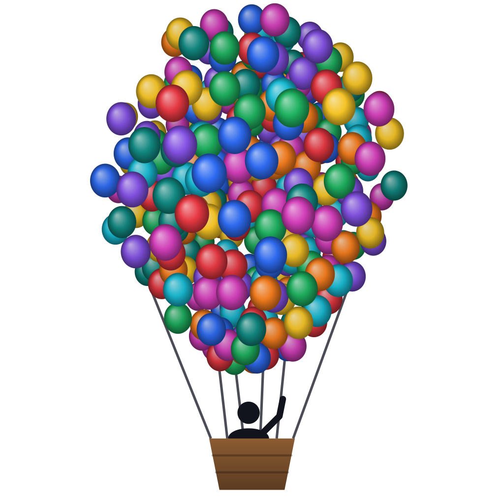

<p align="center"></p>

# GluonSlides

[](https://github.com/agussomacal/GluonSlides/actions/workflows/tests.yml)

A local-first, freeform presentation builder with a twist: **your slides live in a Quarkdown-inspired text format** that you can read, edit, and version-control — while a full drag-and-drop editor keeps everything in sync.

GluonSlides runs entirely on your machine (Python + pywebview, no cloud, no accounts) and treats the `.gl` project file as the single source of truth: every drag, resize, and property change in the GUI is serialized back into clean, human-readable text.

## Download

**[⬇ Download the latest version](https://github.com/agussomacal/GluonSlides/releases/latest)**: Windows, macOS (Apple Silicon) and Linux. Nothing else to install: no Python, no terminal. Test versions (pre-releases) are on the [list of all releases](https://github.com/agussomacal/GluonSlides/releases).

| System | File | Then |
|---|---|---|
| Windows 10/11 | `…-windows-x64-setup.exe` | run it: Start menu entry, no admin rights needed |
| macOS | `…-macos-arm64.dmg` | drag to Applications, open |
| Linux | `…-linux-x86_64.AppImage` | make it executable, double-click (it adds itself to the menu) |

The builds aren't signed yet, so the first start shows a warning; the release page says what to click. At start the app checks whether a newer version is published (it only asks GitHub for the latest release number; nothing is downloaded) and shows a note with a link; turn it off with the checkbox on the start screen. Once installed, double-clicking a `.gl` project opens it in GluonSlides (Windows: an installer option, on by default; macOS: the app declares the type; Linux: the AppImage registers it on first start). To run from source instead, see [Getting started](#getting-started).

## Highlights

- 🖱️ **Visual slide editor**: drag, resize, turn, multi-select, snap-to-grid and smart guides, align and distribute, layers and locking, groups, cut/copy/paste and full undo/redo.
- 📝 **Markdown + LaTeX in every text box**: `**bold**`, lists, inline and display math with KaTeX, your `macros.tex` macros, `\textcolor` and other LaTeX text commands, and a format bar over selected words.
- 📚 **Bibliography and citations, as in LaTeX**: keep your BibTeX entries in the project's `bibliography.bib` (or drop in the one exported from Zotero or JabRef), cite with `\cite`, `\citet`, `\citep` (with autocomplete while typing), numeric or author–year style, and `\printbibliography` for the reference list: a long list continues on extra slides by itself. Missing keys are flagged before you present ([details](docs/user-guide.md#bibliography-bib)).
- 📥 **Import your existing talks**: Beamer (`.tex` or the Overleaf `.zip`), Slidev, PowerPoint and PDF become editable projects. Give the compiled PDF too and it is used as the ground truth for the layout and to recover missing figures. Pictures of equations can be read back to LaTeX (an optional component that runs on your computer).
- 📊 **Columns and tables**: text in columns; tables from a CSV, pasted cells or drawn, and tables **linked** to a results file that update when your script rewrites it, like linked figures.
- 📈 **Your data, straight in**: drop a CSV (or a JSON) of results on a slide and choose what it becomes: a **table**, a **plot** (lines, points, bars, histograms; one line per column, or one per run for long-format data like `run, step, loss`) or a **choice** of its columns or runs. Tick *let me choose while presenting* and a dropdown under the plot switches what is shown, live, in the exported HTML too. Everything stays **linked**: rerun your analysis and the table, the plot and the choices update. Files are copied into the project once (the same file is never copied twice), and **🗂 Project files** shows what uses each file and cleans up the rest ([details](docs/user-guide.md#tables)).
- 🎚️ **Live numbers and interactive plots**: `\var{err}` shows a value from your results (a JSON or CSV file your script writes, followed like linked figures). **Plots** of formulas (written in Python or LaTeX) and data: curves, shaded areas, parametric curves, points with error bars, bars, histograms (also sampled from a formula), heatmaps, contour lines and vector fields, edited as cards or written as a **matplotlib script** (`plt.plot`, `np.random.normal`…), all driven by **sliders, checkboxes, number and text boxes, choices and timed animations** while you present and in the exported HTML. A choice can take its options from a file, and pick what is shown: a column (`y:"=run"`), the runs drawn (`show:"=pick"`), a value by key (`\var{results[opt].acc}`). Any object, and any setting of a plot, can follow a variable too: a position, size, rotation, opacity, visibility, a histogram's bins (`=860 + 300*mu`).
- ➡️ **Drawing**: shapes, lines, arrows, curves, freehand, and **connectors** that stay attached to shapes as they move.
- ▶️ **Present from the app**: builds (objects that appear and disappear click by click), a presenter view with notes, next slide and timer, the audience on a second screen.
- 📤 **Export to HTML and PDF**: an interactive HTML presentation, or a vector PDF; math, fonts and builds included.
- 🗂️ **Several projects in tabs**, with copy and paste between them (figures, tables, macros and styles come along).
- 🧩 **Reusable pieces**: master slides, fields (`\slidenumber`, `\sectiontitle`, a table of contents), named styles, theme colours, macros (components with per-instance overrides).
- 🔤 **The Gluon format (`.gl`)**: the project is a readable text file, with a source view inside the app. Diff it, version it, generate it from a script.
- ❓ **Help built in**: a quick tour, a tutorial presentation, and keyboard shortcuts you can change.

## The Gluon (`.gl`) format

Instead of an opaque JSON blob, a GluonSlides project is a text file heavily inspired by [Quarkdown](https://quarkdown.com/)'s function-call syntax:

```
# Gluon slide project — saved by GluonSlides
.project {My Deck} version:2 width:1920 height:1080 grid:20 darkmode:no nextid:3

.slide {Introduction} id:1
.element.text id:1 x:200 y:200 width:800 height:160 fontSize:42 fontFamily:sans-serif fontColor:#0f172a textAlign:center verticalAlign:center bg:transparent borderCol:transparent borderWidth:0 borderStyle:solid
	Welcome to **GluonSlides** with math: $x^2 + y^2 = r^2$

.element.shape id:2 x:100 y:900 width:300 height:40 bg:#3366ff borderCol:#1e40af borderWidth:2 borderStyle:solid

.slide {Results} id:2
.element.figure id:3 x:400 y:150 width:600 height:450 filePath:figures/plot.png originalPath:/home/me/plot.png bg:transparent borderCol:transparent borderWidth:0 borderStyle:dashed
```

Figures are stored by path only (imported images are copied into the project's `figures/` folder); image data is loaded at runtime and never written into the `.gl` file.

The rules are simple:

- `.project` is the header: name, canvas size, grid, theme, citation style, and the next available ID (slides and elements share one ID counter).
- Each `.slide {Title}` starts a slide.
- Each `.element.<type> id:n k:v k:v ...` places an element; the parameters are exactly the properties you see in the editor's right-hand panel.
- Lines following a `.element.text` directive are its body — Markdown and LaTeX verbatim.

Because the format is deterministic (fixed property order, stable IDs, no timestamps), the file plays nicely with `git diff`, and every position change in the GUI translates into a tiny, reviewable edit. You can also hand-edit the file and reopen it — the parser reports friendly, actionable errors.

The [Gluon format reference](docs/gluon-format.md) describes every directive and parameter, with tips for writing `.gl` files from a script.

## Documentation

- **[User guide](docs/user-guide.md)**: everything the editor does: editing, text, figures and tables, drawing, masters and macros, presenting and exporting, importing talks, tabs, help and shortcuts.
- **[Gluon format reference](docs/gluon-format.md)**: the `.gl` file, directive by directive.
- **[Developer notes](docs/developer.md)**: how the code is organised, and adding an element type.
- In the app: the **?** button in the toolbar (quick tour, tutorial presentation, keyboard shortcuts).

## Getting started

Requirements: Python 3 with GTK bindings (Linux: `sudo apt install python3-gi python3-gi-cairo gir1.2-gtk-3.0`) and the packages in `pyproject.toml` / `dependencies.yaml`.

```bash
uv run app.py      # or: python3 app.py
```

On first start, missing JS/CSS libraries from `dependencies.yaml` are downloaded into `libs/`. Recent projects and inspector settings are stored per user (`~/.config/gluonslides` on Linux).

Create a project (pick a folder — you get `MyDeck.gl` plus a `macros.tex` for your LaTeX macros), add elements from the toolbar, and export with the HTML/PDF buttons. Autosave runs continuously; your project file always reflects the current canvas.

`python3 app.py MyDeck.gl` opens that project directly. `python3 app.py --version` prints the version; `--self-check` checks that the files, libraries and Python packages are all there without opening a window; `--smoke-test` opens the window, checks the page started and closes it.

## Building the installable app

The app can be bundled, with Python, its packages and the JavaScript libraries and fonts, into a program that runs without `uv` or a terminal (PyInstaller, recipe in `packaging/`). Build on the system you are building for:

```bash
uv sync --group build
uv run python packaging/build.py          # --smoke: also open the built app once
uv run python packaging/build.py --archive --package   # + download file and installer
```

`--package` makes the installer: an AppImage on Linux (downloads `appimagetool`), a `…-setup.exe` on Windows (needs [Inno Setup 6](https://jrsoftware.org/isinfo.php); recipe in `packaging/windows/`). The app's icon is `packaging/icon.png` (and `icon.svg`), drawn by `packaging/make_icon.py`: a balloon made of many small balloons in nine colours, the 3 × 3 colour pairs carried by gluons. The icon is CC0 (public domain, see `packaging/ICON-LICENSE`); the build makes the Windows `.ico` and macOS `.icns` from it.

The result is `dist/GluonSlides/` (on macOS `dist/GluonSlides.app`), about 60 MB (25 MB compressed) on Linux. The build runs the app's `--self-check` on it, which also does each kind of backend work once (project file, figures, PDF, fonts), so a package missing from the bundle shows up there. Packages the app doesn't use are left out (see `UNUSED` in the recipe). Recent projects and settings stay in the user's config folder, never inside the app.

- **Windows** uses the Edge WebView2 built into Windows 10/11; **macOS** its own WebKit.
- **Linux** uses the desktop's own WebKitGTK, GTK and system libraries (`gir1.2-webkit2-4.1`, normally installed with the desktop), not bundled copies.
- Exporting a vector PDF needs Chrome, Chromium or Edge installed; without one, the image-based PDF is used. PDF/EPS *figures* need Poppler (`pdftoppm`).
- Unsigned builds show a warning on first start (see `packaging/RELEASE_NOTES.md` for what to click on each system).

### Releases

`.github/workflows/release.yml` builds all three on GitHub's machines (Linux on Ubuntu 22.04, Windows, macOS on Apple Silicon), runs `--self-check` and opens each built app once:

- **Push a version tag** (`git tag v0.2.0 && git push origin v0.2.0`): the builds are published on a Release page, with `packaging/RELEASE_NOTES.md` as instructions. The tag must match `__version__` in `backend/__init__.py` (and `pyproject.toml`). A tag with a suffix, like `v0.2.0-rc1`, makes a pre-release for testing.
- **Run it by hand** (*Actions → Release builds → Run workflow*): the builds are attached to the run as downloads, with no Release.

## Tests

```bash
npm install            # once: the browser driver for the end-to-end tests
npm test               # end-to-end tests: the editor driven in a headless Chrome
npm run test:backend   # Python backend tests
```

Every push and pull request runs both on GitHub (the *Tests* workflow, badge at the top). See [tests/README.md](tests/README.md) for what each kind of test covers and how to add one.

## License

The code is under the GPL-3.0: see [LICENSE](LICENSE). The icon is CC0 (public domain): see [packaging/ICON-LICENSE](packaging/ICON-LICENSE).
